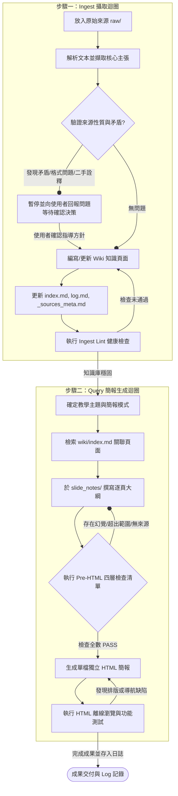

# LLM Wiki 知識庫建立與教學 HTML 簡報成果作業報告

- **學生/組別**：第九組
- **主題領域**：軟體工程標準（IEEE 830 / 1016 / 829）與專案實務（《K33p_1t_s1mpl3》文字解謎遊戲）
- **繳交日期**：2026 年 11 月

---

## 一、LLM Wiki 主題與簡短介紹

### 1. 知識庫主題
本知識庫主題為**「軟體工程標準規範與實務專案落地」**。採用 Andrej Karpathy 所提出的 **LLM Wiki 方法論**，建構一個介於原始文檔（Raw Sources）與最終應用之間的持久化、可持續累積的 Markdown 知識庫。

### 2. 簡短介紹
傳統 RAG 在每一次提問時都需要重新檢索碎片化的文檔，缺乏知識的「累積與編譯」；本專案透過 LLM 維護結構化、雙向互聯的 Wiki 頁面，將軟體工程三大國際標準（IEEE 830 SRS 需求、IEEE 1016 SDD 設計、IEEE 829 STD 測試）與真實學生專案（第九組網頁文字解謎 RPG 遊戲《K33p_1t_s1mpl3》的 PEP、SRS、SDD 初稿）進行深度整合與交叉驗證。

### 3. LLM Wiki 成果與連結
- **Wiki 目錄索引**：`wiki/index.md`
- **正式知識頁面（共 5 篇核心頁）**：
  1. `wiki/software_engineering/SRS.md`：IEEE 830 需求規範結構、功能與非功能需求條目及 RTM 追溯矩陣。
  2. `wiki/software_engineering/PEP.md`：專案執行計畫六大結構、16 週五階段時程里程碑、分工與風險管理。
  3. `wiki/software_engineering/SDD.md`：IEEE 1016 (1998/2009) 設計實體 10 大黃金屬性、4 大設計視圖與現代視點演進。
  4. `wiki/software_engineering/STD.md`：IEEE 829 八大經典測試文件與 ISO/IEC/IEEE 29119-3 三層體系。
  5. `wiki/software_engineering/K33p_1t_s1mpl3.md`：第九組專題世界觀、五重人格、純前端事件驅動狀態機與 100% 防呆指標。
- **操作日誌**：`wiki/log.md`（依時間戳記忠實記錄 Ingest、Query、Lint 等操作）
- **原始資料元資料登記**：`raw/software_engineering/_sources_meta.md`（共登記 7 份來源檔案）

---

## 二、教學型 HTML 簡報成果

本專案利用已建構好的 Wiki 知識庫作為唯一真實來源（Ground Truth），產出了可直接離線瀏覽的教學簡報：

- **教學 HTML 簡報檔案**：`presentation/sdd_tutorial.html`
- **簡報主題**：《解構 IEEE Std 1016：軟體設計描述 (SDD) 撰寫邏輯與標準實務》
- **教學目標與對象**：針對初學者（課堂老師與同學），以循序漸進的方式解說為什麼需要 SDD、設計實體 10 大屬性、4 大設計視圖、現代視點演進與五步撰寫法則。
- **視覺與技術亮點**：
  1. **手帳清新可愛風**：捨棄冰冷黑底 AI 感，採用溫潤鵝黃、莫蘭迪粉藍與櫻花粉配色，搭配圓角卡片與手帳便簽排版。
  2. **100% 離線可用**：完全無外部 CDN 依賴，內建流暢 CSS/JS 鍵盤（左右箭頭、空白鍵）導覽與動態進度條。
  3. **可追溯性**：簡報每一頁均可在 `slide_notes/se_ieee1016_tutorial_outline.md` 找到對應的 Wiki 來源，末頁嚴格依照規範列出標準文獻清單。
- *(額外成果)*：另有一份專屬於第九組的專題發表簡報 `presentation/index.html`，並於入口 `index.html` 整合雙簡報導航。

---

## 三、Loop / Graph 流程架構設計

本系統的運作由嚴謹的狀態機/迴圈圖（Loop & Graph）驅動，涵蓋 **Ingest（攝取）**、**Query（查詢與生成）** 與 **Lint（健康檢查）** 三大核心子流程。

### 1. 流程圖（Text / Mermaid 流程圖）

### 2. 核心環節說明
1. **取得資料 (Ingestion)**：
   讀取 `raw/software_engineering/` 下的 PDF/Word 原始來源，擷取標題、作者、日期、核心主張與限制。
2. **先討論、後生成 (Human-in-the-loop Gate)**：
   在真正寫入 Wiki 之前，系統必須先向使用者報告來源理解狀況與異常點。若發現矛盾或文件性質不符，**強制中斷並等待指令**，絕不擅自猜測。
3. **編譯 Wiki (Compilation)**：
   將確認後的知識依照統一格式（YAML Frontmatter、核心概念、實務案例、注意事項、來源出處）寫入 `wiki/`，並同步維護目錄 `wiki/index.md` 與時間軸日誌 `wiki/log.md`。
4. **大綱先導與內容審查 (Slide Notes & Verification)**：
   製作簡報前，不直接生成 HTML 程式碼，而是先在 `slide_notes/` 撰寫大綱，逐頁標註教學目的、核心訊息、視覺構想與 Wiki 頁面來源對應。
5. **產出與技術驗收 (Generation & Validation)**：
   通過「結構、事實（無幻覺）、語言、離線技術」四層檢查後，才輸出 `presentation/` HTML，並進行瀏覽器渲染與鍵盤交互驗收。

### 3. 重複執行（Loop）與檢查重測（Retry）的環節
- **Ingest 階段的重複檢查**：每次寫入 Wiki 後，自動執行 Lint 檢查連結是否失效、是否有孤立頁面；若有失效則回退修正。
- **Query 階段的大綱重構迴圈**：若大綱檢查清單中發現某個主張沒有 Wiki 支援（涉嫌誇大或幻覺），退回大綱編輯階段刪除或補充查證，通過後才准許進入 HTML 生成。
- **為什麼這樣設計？**：
  因為「生成 HTML 程式碼」的成本極高，一旦在程式碼層次才發現觀念錯誤或架構漏洞，重構代價巨大；**在結構化大綱（Markdown）階段就把關事實真相，能以最小代價保證零幻覺。**

---

## 四、實際執行紀錄與反思

### 1. 一次實際執行的結果與檢查紀錄（來自真實操作 log）
- **操作時間**：2026-11-11
- **來源攝取處理**：
  - 讀取 6 份原始來源（IEEE 830、IEEE 1016、IEEE 829、第九組 PEP、SRS、SDD）。
  - **觸發中斷回報**：
    1. 發現 `se_ieee830_1998.pdf` 僅有 2 頁大綱骨架，非官方標準全文。
    2. 發現 `se_ieee1016_2009.pdf` 內文標記為 1998 年版本，檔名年份不符。
    3. 發現 `se_ieee829_1983.pdf` 為 Sneed & Seidl 學術論文，屬二手詮釋資料。
  - **使用者決策確認**：使用者指示 IEEE 830 作為結構範例、保留舊版 1016 並補充真 2009 版、IEEE 829 標明學術論文定位。
- **Lint 檢查報告**：
  - 來源存在性檢查：6/6 全部 PASS。
  - Wiki 檔案與 Index 連結：5 篇核心頁面全部 PASS。
  - 內部相互引用：無斷鏈，PASS。
  - 幻覺與誇大檢查：所有功能代碼（F-01~F-12）、量化指標（0.1s、100% 防呆）均有文檔出處，PASS。

### 2. 深入反思：哪一個節點最常出錯？如何調整檢查流程？

#### (1) 最常出錯的節點：**「原始資料理解與驗證節點 (Raw Ingestion & Grounding)」**
在實務執行中，最容易出錯的不是寫文章或生成 HTML，而是**「對原始來源內容的錯誤假設」**：
- 人類給的檔名可能標注 2009 年，但內文其實是 1998 年標準。
- 檔名叫做 IEEE 830 標準，但點開其實只有 2 頁大學實驗室的練習模板骨架。
- 若 AI 不加思索直接以檔名或片面檢索為真，就會在 Wiki 中編織出嚴重的錯誤幻覺，導致整座知識庫的根基腐爛。

#### (2) 檢查節點的「大幅前移」策略
發現此問題後，我們將檢查機制做了兩次關鍵的**「前移 (Shift-Left)」**：
1. **將來源驗證前移至 Ingest Step 3（寫入 Wiki 之前）**：
   在尚未建立任何 `.md` 頁面前，強制由 AI 提取來源全文，比對標準年份、作者、頁數與文件性質，並**強制作為中斷點回報給人類確認**。只有人類確認後，才允許產生 Wiki 頁面。
2. **將幻覺檢查前移至 `slide_notes/` 大綱階段（生成 HTML 之前）**：
   過去常在簡報做完後才人工校對內容是否屬實；現在強制在 `slide_notes/_template.md` 建立逐頁大綱時，每一頁都必須填寫 `Wiki 來源` 與 `核心出處`，並在草稿階段勾選「幻覺檢查清單」。確認無誇大、無虛構後，才呼叫程式碼生成引擎。

#### (3) 工作流（Workflow / Graph）的演進與修改
因為上述反思，我們正式在專案的指導規範 `AGENTS.md` 中固化了三項規則：
1. **矛盾與性質不符時「立即暫停」條款**：禁止 AI 自行猜測或妥協不同來源的矛盾，必須第一時間回報。
2. **強制納入 `_sources_meta.md` 元資料登記表**：每一份 raw 檔案都必須明確記錄其授權、性質（標準原文、學術論文或教學範例）。
3. **強制大綱模板與預檢門檻**：取消「直接提問 ➔ 直接生成簡報」的捷徑，確立了「Wiki ➔ Slide Notes 大綱與檢查 ➔ HTML 呈現」的嚴謹管線（Pipeline）。這使得整個知識庫與簡報完全禁得起學術與工程檢驗！
